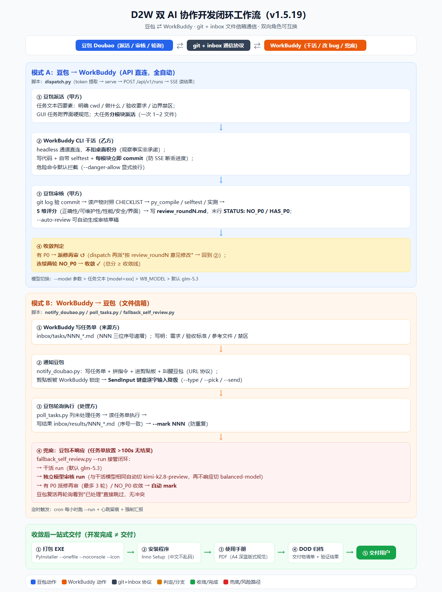

<div align="center">

# 🚀 D2W — 双 AI 协作开发闭环

> **两个 AI 互相派活，你只需要喝茶。**
>
> 豆包 ⇄ 腾讯 WorkBuddy · 一个派活审核、一个写码改 bug，
> 自动跑通 **需求 → 写码 → 审核 → 改 bug → 收敛 → 打包 EXE → 安装程序 → 使用手册** 全流程。
> **无需手动切换窗口、无需手动复制代码、无需手动复核——AI 闭环，你拍板。**

[](https://github.com/Mine1178/d2w-skill)
[](https://github.com/Mine1178/d2w-skill)
[](https://github.com/Mine1178/d2w-skill/blob/master/LICENSE)

</div>

---

## 📖 目录

- [🔥 为什么是 D2W？](#-为什么是-d2w)
- [✨ 核心特性](#-核心特性)
- [🧭 工作流全景](#-工作流全景)
- [🎯 两种模式](#-两种模式)
- [🚀 30 秒上手](#-30-秒上手)
- [📋 常用命令](#-常用命令)
- [📁 项目结构](#-项目结构)
- [⚠️ 红线](#️-红线)
- [📄 License](#-license)
- [☕ 感谢赞助](#-感谢赞助)

---

## 🔥 为什么是 D2W？

| 痛点 | D2W 解决方案 |
|---|---|
| 一个 AI 写代码总觉得不放心 | **双 AI 互审**：豆包派活 + 审核，WorkBuddy 干活 + 改 bug，P0/P1/P2 三级评分收敛 |
| 用 AI 工具积分嗖嗖扣 | **CLI 通道直连 WorkBuddy，不消耗桌面客户端积分**——派多少活都行，不用担心账单 |
| AI 写一半断了、代码丢了 | **分模块派活铁律**：一次 1~2 个文件 + 每模块立即 commit，SSE 断了从上次 commit 续跑 |
| 审核 AI 写的代码太累 | **管道化自动审核**：`--auto-review` 自动生成审核草稿，AI 只填判断，5 维评分锚定 |
| 写完代码还要手动打包 | **一站式交付**：自动派活打包 PyInstaller → Inno 安装程序 → PDF 使用手册 → DOD 归档 |
| 不同 AI 切换来切换去 | **角色可互换**：豆包派活给 WorkBuddy，或 WorkBuddy 派活给豆包，同一套协议双向跑 |

> 适合场景：多智能体协作开发、双模型代码互审、Python 命令行工作流自动化、桌面工具从需求到安装包的闭环交付。

## ✨ 核心特性

- **∞ 无穷积分派活**：CLI/API 通道直连 WorkBuddy headless，**不走桌面客户端积分计量**（观察事实非承诺）
- **双模式闭环**：模式 A 豆包→WorkBuddy（全自动 API）；模式 B WorkBuddy→豆包（文件信箱 + 兜底自闭环）
- **🛡️ 安全边界默认开启**：危险命令（删除/格式化/关机/注册表）自动拦截，token 仅绑 loopback 不外传
- **🤖 模型自由切换**：默认 glm-5.3，一句话切 kimi-k3-1 / kimi-k2.8-preview / DeepSeek-V4 / 混元4 / 免费阶跃
- **🧠 独立审核兜底**：豆包不响应时 WorkBuddy 自审自查，独立模型审核链（glm→kimi→balanced）自动回退
- **📦 一站式交付**：开发收敛后自动派活打包 EXE、安装程序、PDF 使用手册、DOD 归档
- **🎨 GUI 硬规范**：默认 Wifibond 左导航布局、11 项界面验收（含关于页赞助弹窗、文本排版无孤行）
- **🔄 跨盘符自动探测**：换机/换盘符零配置，自动定位 WorkBuddy CLI
- **📝 冒烟自检一条命令**：`--smoke` 自动验证环境 → 派最小任务 → 验证 commit 落盘

## 🧭 工作流全景



## 🎯 两种模式

| 模式 | 谁干活 | 谁派活/审核 | 用什么 | 特点 |
|---|---|---|---|---|
| **模式 A** | WorkBuddy | 豆包 | `dispatch.py`（API 直连 CLI） | 全自动：派活 → 干活 → 审核 → 派修，收敛闭环 |
| **模式 B** | 豆包 | WorkBuddy | `inbox/tasks` + `poll_tasks.py` | 文件信箱：写任务单 → 通知 → 轮询执行 → mark |

- **模式 B 兜底**（v1.5.18+）：任务单放置超 100s 无结果 → `fallback_self_review.py --run` 自动接管
  （干活 run + 独立模型审核 run → 收敛/派修 → 自动 mark），豆包复活看到"已处理"直接跳过，无冲突
- **混用**：同项目可 A/B 并行（不同工作区），或一方干活另一方审核

## 🚀 30 秒上手

### 前置条件

- Windows 10/11 + Python 3.9+（v1.5.19 起 3.9~3.11 全部兼容）
- [WorkBuddy 桌面版](https://workbuddy.tencent.com/) 运行并登录

### 初始化项目（技能内工具，在技能目录内运行）

```bash
git clone https://github.com/Mine1178/d2w-skill.git
cd d2w-skill
python scripts/init_project.py D:\path\新项目 --with-templates
# 初始化后：dispatch / poll_tasks / notify_doubao / fallback_self_review 已部署到项目根
```

### 派第一个活（项目根运行，无前缀）

```bash
python dispatch.py "在 <cwd> 目录：写一个 hello.py，打印 'Hello from WorkBuddy'。
要求：1) py_compile 通过；2) git commit。不要修改其他文件。" --timeout 120
```

### 冒烟自检（项目根运行）

```bash
python dispatch.py --smoke --cwd D:\path\test-project
```

> 💡 **命令语境**：部署到项目根的 4 个脚本（dispatch / poll_tasks / notify_doubao / fallback_self_review）
> 一律在**项目根**用无前缀命令运行；只有技能内工具（init_project.py / gen_checklist.py）用 `scripts/` 前缀。

## 📋 常用命令（项目根运行）

| 命令 | 作用 |
|---|---|
| `dispatch.py "任务"` | 派活给 WorkBuddy（∞ 不扣积分） |
| `dispatch.py --model kimi-k3-1 "任务"` | 切换最强长程模型 |
| `dispatch.py --status` | 查 token / CLI / serve 状态 |
| `dispatch.py --smoke` | 一键冒烟自检 |
| `dispatch.py --auto-review` | 自动生成审核草稿 |
| `dispatch.py --queue tasks.txt` | 批量派活 |
| `dispatch.py --list-runs` | 查派活历史 |
| `dispatch.py --stop-all` | 清理孤儿进程 |
| `poll_tasks.py` | 模式 B 轮询 WorkBuddy 派来的活 |
| `fallback_self_review.py --run` | 豆包不响应时自动兜底（干活+独立审核+收敛+mark） |
| `notify_doubao.py --send --task "..."` | 通知豆包处理任务单（剪贴板被锁自动键盘降级） |

## 📁 项目结构

```
d2w-skill/
├── SKILL.md                  # 技能入口（双模式/派活/审核/交付/常见坑）
├── CHANGELOG.md              # 版本记录 v1.0.0 → v1.5.19
├── README.md                 # 本页
├── scripts/
│   ├── dispatch.py           # 派活桥（token/serve/SSE/模型切换/危险拦截/--smoke）
│   ├── poll_tasks.py         # 任务队列轮询
│   ├── notify_doubao.py      # 模式 B 通知器（剪贴板/键盘输入降级）
│   ├── fallback_self_review.py # 模式 B 兜底自审自查
│   ├── init_project.py       # 项目初始化向导
│   ├── gen_checklist.py      # PRD → CHECKLIST 自动生成
│   ├── sync_copies.py        # 副本同步防御
│   └── extract_jwt.py        # 备用 token 扫描
├── references/
│   ├── setup.md              # 环境/认证/模型清单
│   ├── methodology.md        # 完整方法论（踩坑沉淀）
│   └── troubleshooting.md    # 真实踩坑记录
└── assets/
    ├── templates/            # 模板（PRD/CHECKLIST/审核/任务/手册/DOD/selftest）
    ├── ui_spec/              # Wifibond 布局规范 + PDF 手册样式
    ├── money_code/           # 收款码（赞助用）
    └── d2w_workflow_v1.5.19.png  # 工作流全景图
```

## ⚠️ 红线

- 派活文本必须明确 cwd / 做什么 / 验收要求 / 禁区
- 大任务分模块派，每模块立即 commit
- 审核方只审不改代码；干活方无权改 PRD/CHECKLIST/审核基线
- token 绝不写进 commit、文档、聊天
- ∞ 积分通道是 CLI/API 实测观察，别规模化滥用（WorkBuddy 可能随时改计量方式）

## 📄 License

MIT

---

## ☕ 感谢赞助

如果这个工具帮你省了时间，可以请作者喝杯咖啡，你的支持会让这个项目持续更新：

<div align="center">
  
  
</div>

**支付宝 / 微信扫码均可**，感谢每一份支持 ❤️

问题反馈：[Issues](https://github.com/Mine1178/d2w-skill/issues)
